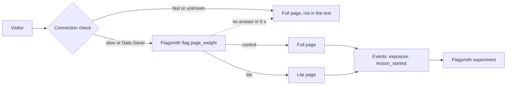
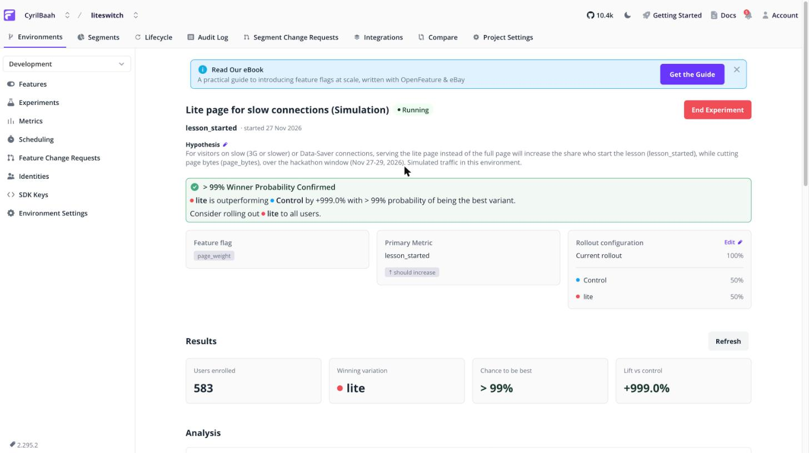
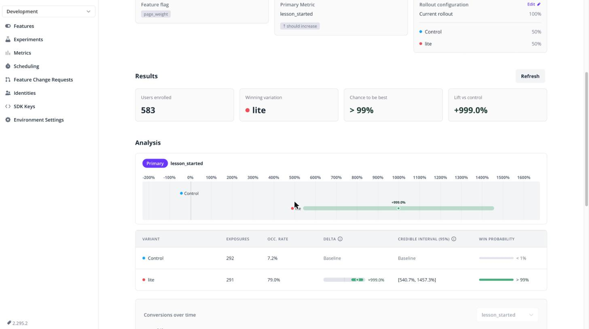

# LiteSwitch

**A data-saver mode for any website: slow or Data-Saver visitors get a lite page, and a Flagsmith A/B test proves whether it helps.**

- **What:** an open-source drop-in that reads the browser's connection signals, lets a Flagsmith flag pick the full or lite page for slow visitors, and measures the result with Flagsmith Experimentation.
- **Who:** people on 2G/3G or with Data Saver on, mostly in Africa and South Asia, who pay for every MB (GH₵0.1145/MB on MTN Ghana pay-as-you-go).
- **Result (simulated 3G visitors, not real people yet):** **7.2% vs 79.0%** started the lesson (full vs lite), with a **> 99%** chance that lite is best, and about **6.3 MB (≈ GH₵0.72)** saved per fully loaded visit. Details in [Results](#results).



**Next steps:** publish the kit as an **npm package**, a **browser extension** that applies lite mode to any site, and a **WordPress plugin**.

**Live demo:** https://liteswitch.vercel.app (a free lesson, "Git in 10 minutes")

> Built for [Toggle Wars: The Flagsmith Experimentation Hackathon](https://www.wemakedevs.org/hackathons/flagsmith) by [WeMakeDevs](https://www.wemakedevs.org), Track 01: **Test Something Real**. Feature flags and experiments are powered by [Flagsmith](https://flagsmith.com).

## Demo video

**Demo video:** [Watch the 3-minute demo (link coming soon)](#demo-video) <!-- TODO: replace #demo-video with the video URL -->

## Problem

In much of Africa and South Asia, 1 GB of mobile data costs a real share of monthly income. In Ghana, MTN's pay-as-you-go rate is GH₵0.1145 per MB, about GH₵117 per GB, for anyone without a bundle. Browsers already report when a connection is slow or Data Saver is on, but most sites ignore that and send the same heavy page to everyone.

## Hypothesis

For visitors on slow (≤3G) or Data-Saver connections, a lite page will get more of them to start the lesson than the full page does.

## How it works

1. **Sense the connection.** The browser reads `navigator.connection` (`effectiveType`, `saveData`, `rtt`). [`proxy.ts`](proxy.ts) runs before each page: it gives every visitor one stable id cookie and mirrors the `Save-Data` request header into a cookie the browser can read.
2. **Sort the visitor.** Slow (`slow-2g`, `2g`, `3g`, or Data Saver on), fast, or unknown (Safari and Firefox don't expose a connection type). Fast and unknown visitors always get the full page and never contact Flagsmith.
3. **Ask Flagsmith (slow visitors only).** Flagsmith decides **full** or **lite** for that visitor.
4. **Render the variant.** The text and code are in the first HTML on every connection; only the heavy parts change:

   | | Full | Lite |
   |---|---|---|
   | Intro video | 1080p, autoplay (~6 MB) | 8 KB poster; 360p (~0.24 MB) only on tap |
   | Images | retina PNGs (~300 KB) | small lazy JPEGs (~29 KB) |
   | Font | web font (Inter, ~47 KB) | system font, 0 KB |
   | Total, without tapping play | ~6.5 MB (video autoplays) | ~0.19 MB |
   | Total, after tapping play | ~6.5 MB | ~0.43 MB (adds the 0.24 MB video) |

5. **Show the cost.** A footer "data-cost receipt" shows how many MB this page used and what that costs at MTN Ghana's pay-as-you-go rate.
6. **Fail safe.** No key, blocked cookies, Flagsmith down, or no answer within 5 s: everyone gets the full page and nothing is recorded.

## How Flagsmith is used

**Traits → flag → experiment → segment rollout.**

1. **Identity and traits.** Each slow visitor is identified by their visitor-id cookie, with the traits `net_type` (e.g. `3g`), `save_data` (true/false) and `rtt_ms`. That's one request: `flagsmith.init({ environmentID, enableEvents: true, identity, traits })`.
2. **Flag.** The multivariate flag `page_weight` holds a JSON value. Control (full) is `{"video":"autoplay-hd","images":"hd","fonts":"web","embeds":true}`, and variation `lite` is `{"video":"tap-to-load-360p","images":"low-lazy","fonts":"system","embeds":false}`. The page reads it with `getAllFlags()`, which records nothing.
3. **Experiment.** Flagsmith Experimentation runs `page_weight` as an A/B test: 100% rollout, 50/50 split. It runs in two environments, **Development** for simulated visitors and **Production** for real ones.
   - **Exposure:** recorded with `trackExposureEvent('page_weight', …)` when the variant is put on the page, and only if Flagsmith says `inExperiment === true` and the flag value is one we recognise. A visitor who gives up during a heavy download still counts as "shown full, didn't start".
   - **Metrics:** `lesson_started` (primary, occurrence), `lesson_completed` (occurrence), `page_bytes` (mean bytes per page view). Each is sent with `trackEvent` under the same identity and flushed right away, because a 3G visitor may leave before the SDK's 10-second batch.
4. **Segment rollout (after the experiment).** The segment `slow_or_saver` (`net_type` in `slow-2g, 2g, 3g` OR `save_data = true`) is for shipping the winner. A segment override sets `page_weight` to the winning value for slow visitors only, and everyone else keeps the full page.

Everything to create in the dashboard is in [`docs/flagsmith-setup.json`](docs/flagsmith-setup.json).

## Use LiteSwitch on your site

A 10-minute guide. You need a Flagsmith account and a page with something heavy on it: a video, big images, embeds.

**1. Create the Flagsmith side (about 5 minutes).** [`docs/flagsmith-setup.json`](docs/flagsmith-setup.json) lists everything to create by hand, with the exact names the code expects:
- a warehouse in each environment (Environment Settings → Warehouse → Flagsmith)
- the multivariate flag `page_weight`: control = the full JSON, one variation `lite`
- the metrics `lesson_started`, `lesson_completed` and `page_bytes` (if you rename `lesson_started` to your own primary action, use that same event name in your code's `track(...)` calls; Flagsmith matches events by exact name)
- the segment `slow_or_saver`, for rolling out the winner later
- the experiment: rollout 100%, split 50/50, created last, because it starts as soon as you create it

**2. Add the code (about 5 minutes).** Pick the path that matches your site:
- **Any website, no build step:** copy [`examples/plain-html/liteswitch.js`](examples/plain-html/liteswitch.js) next to your page and follow [`examples/plain-html/index.html`](examples/plain-html/index.html):
  ```js
  import { decide } from "./liteswitch.js";
  const choice = await decide({ environmentID: "<client-side key>" });
  // render choice.config (full or lite), then:
  choice.recordExposure();          // once, when the variant is on the page
  choice.track("lesson_started");   // your conversion event
  ```
- **Next.js:** run `npm install @flagsmith/flagsmith@12.6.0`, then copy `lib/liteswitch/`, `lib/flags.ts` and `proxy.ts`, then wrap your page in a provider like `app/lesson/VariantProvider.tsx`. `proxy.ts` gives every visitor a stable id cookie and passes the `Save-Data` header to the browser.

**3. Check it.** Put the Flagsmith client-side key in, and throttle Chrome to "3G" in DevTools (or force `navigator.connection` with `chrome://flags` → *Force effective connection type*). A slow visitor should get a decision from Flagsmith; a fast visitor always gets the full page and never contacts Flagsmith.

The rules that keep the experiment honest are built in, so keep them if you adapt the code:
- **Only slow visitors are enrolled.** Fast visitors would dilute the result. Safari and Firefox can't report a connection type, so they stay out.
- **The exposure is recorded when the variant is put on the page, and only if Flagsmith says the visitor is in the experiment.** Never use `getExperimentFlag`, which records at read time.
- **Every failure falls back to the full page with nothing recorded:** a missing key, blocked cookies, a 5-second timeout, or an error.

## Run this repo

1. `npm install`
2. Copy `.env.example` to `.env.local` and set `NEXT_PUBLIC_FLAGSMITH_ENVIRONMENT_KEY`. Use the **Development** key locally, so your testing never lands in the real results.
3. Create the Flagsmith side (above). Without it, everyone gets the full page and no experiment events are sent.
4. `npm run dev`, then open http://localhost:3000.

**Simulated visitors** ([`scripts/simulate.ts`](scripts/simulate.ts)): `npx playwright install chromium` once, then `npm run simulate`.
- By default it targets this project's hosted `sim` preview, not your local server. To use your own, set `SIM_URL` (a `liteswitch-git-…` preview, or `http://localhost:3000` with `NEXT_PUBLIC_SIM_MODE=1` in `.env.local`) in `.env.local`. Production is always refused.
- Vercel preview deployments are protected, so set `VERCEL_AUTOMATION_BYPASS_SECRET` in `.env.local` (Vercel → Settings → Deployment Protection → Protection Bypass for Automation). Without it every visit is blocked and the run stops.
- The Flagsmith experiment must be running in the environment that deployment uses (Development for previews), or nobody is enrolled and the run stops after 10 visits.
- Each simulated visitor gets a fresh identity, Chrome DevTools throttling (400 kbit/s down, 400 ms round trip) and a random 3–15 s patience, counted from page load. It clicks "Start lesson" only if the content appears in time.
- Every visit is saved to `sim-results/`.

## Results

Simulated and real visitors are reported **separately**. All figures below come from the Flagsmith dashboard or from the saved per-visit files in [`sim-results/`](sim-results/); none are invented.

### Simulated visitors (Flagsmith Development environment)

**How they were made:** 595 scripted visits by [`scripts/simulate.ts`](scripts/simulate.ts), in two runs on 27 Nov 2026, against the `sim` preview deployment.
- Each visitor got a fresh identity and Chrome DevTools throttling of **400 kbit/s down with a 400 ms round trip**.
- Each also got a random **patience of 3–15 s** (9 s on average), counted from page load. It clicked "Start lesson" only if the content appeared within that time; otherwise it left.
- These are not people. The test shows how load time interacts with a plausible range of patience.

**Flagsmith's analysis** (experiment "Lite page for slow connections (Simulation)", as of 27 Nov 2026 09:55 UTC):

| | Full (control) | Lite |
|---|---|---|
| Exposures | 292 | 291 |
| Started the lesson (`lesson_started`) | 7.2% | **79.0%** |
| Lift vs control | baseline | **+999.0%** |
| 95% credible interval | baseline | **[+540.7%, +1457.3%]** |
| Win probability | < 1% | **> 99%** |

The credible interval is entirely above zero; it doesn't cross it. Flagsmith shows "> 99% Winner Probability Confirmed" (583 users enrolled). The interval is wide because full's start rate is so low that a few visitors more or less swing the ratio a lot.

**The script's own measurements** (both runs combined): run 1 is [`sim-results/sim-2026-11-27T09-38-11-734Z.json`](sim-results/sim-2026-11-27T09-38-11-734Z.json), run 2 is [`…09-52-34-279Z.json`](sim-results/sim-2026-11-27T09-52-34-279Z.json), and the smoke test is [`…09-35-56-902Z.json`](sim-results/sim-2026-11-27T09-35-56-902Z.json).

| | Full (control) | Lite |
|---|---|---|
| Enrolled visitors | 294 | 290 |
| Started the lesson | 21 (7.1%) | **226 (77.9%)** |
| Completed the lesson (scripted, see below) | 15 (5.1%) | 132 (45.5%) |
| Content on screen before the visitor gave up | 21 of 294 | 226 of 290 |
| Average time until content was visible (when it was) | 13.3 s | **6.2 s** |
| Page weight, fully loaded | 6.50 MB ≈ GH₵0.744 | **0.19 MB ≈ GH₵0.022** |

- **Completions are scripted, not measured.** The script clicks "Mark complete" for a random 60% of visitors who started, after 1–4 s. So completions follow starts by design (60% of 77.9% ≈ 46.7%; we got 45.5%), and they say nothing new about lite vs full. They only show that the `lesson_completed` event works. The real findings are lesson starts and time-to-content.
- **Data and money saved:** about **6.3 MB and GH₵0.72 per visit**, fully loaded, at MTN Ghana's pay-as-you-go rate (GH₵0.1145/MB, no bundle). If a lite visitor taps play, the 360p video adds 0.24 MB (≈ GH₵0.027).
- **Bytes before leaving** were 0.29 MB (full) vs 0.20 MB (lite) on average. That's low for full only because most full visitors gave up before the page finished loading, so it says little about page weight. The fully loaded numbers are the fair comparison.

**Who is counted, and the small gaps:**
- 11 scripted visitors were **not enrolled**: Flagsmith didn't place them in the experiment, most likely because its answer didn't arrive within the 5 s limit. They got the full page and appear in neither table.
- A first run was **cut short** after 95 enrolled visits, when the Vercel bypass secret was rotated mid-run. Its 16 failed visits are recorded in its results file; the second run had 0 failures.
- Development also contains a **5-visit smoke test** of the script and **one test browser** used by the author (Cyril, with Claude) to check the setup. Both are in Flagsmith's numbers but not in the script's table.
- **The two tables differ slightly in their counts.** Flagsmith counts 583 users, while the script saw 584 enrolled visits, plus the 6 extra identities above. A few exposure events likely didn't arrive: the SDK sends events with a normal request, which can be cut off when a page closes. The statistics come from Flagsmith's count.





### Real visitors (Flagsmith Production environment)

The Production experiment is running at https://liteswitch.vercel.app, but it has **0 exposures** so far: no real slow-connection visitors have been enrolled yet. Fast visitors and Safari/Firefox visitors get the full page and are, by design, never enrolled. So there is **no real-world result yet**, and the simulated result above should not be read as one.

### What we'd do next

When Production has enough real slow-connection visitors, compare its result with the simulation. If lite still wins, roll it out with a segment override on `slow_or_saver`: slow visitors get lite, everyone else keeps the full page.

## Limitations

- **Chromium only.** `navigator.connection` exists only in Chromium browsers (Chrome, Edge, Opera, Samsung Internet), so Safari, iOS and Firefox visitors never enter the experiment.
- **`Save-Data` is rare now.** Chrome removed Lite mode in 2022, which was the main source of the header, so slow visitors are found mostly through `effectiveType`.
- **Simulated visitors aren't people.** Their patience (3–15 s) is our assumption. They show how load time interacts with patience, not how humans behave, which is why their results are reported apart from real visitors.
- **Bytes are partly estimated.** Browsers don't report a video that's still streaming, so the receipt estimates video bytes from how much has buffered. A visitor who leaves early also pays for less than the full page weight.
- **The price is a worst case.** GH₵0.1145/MB is MTN Ghana's no-bundle rate; bundles cost less. The receipt counts 1 MB as 1,000,000 bytes, so if MTN bills 1,048,576 bytes per MB the real charge is about 5% lower.
- **No real sample yet.** The Production experiment has had 0 slow-connection visitors so far, so the only result is the simulated one.
- **Flagsmith Experimentation is in beta.**

## How AI tools were used

- **Claude Code** (Anthropic) wrote most of the code and docs in this repo, working from a design reviewed before any code was written. The [gstack](https://github.com/garrytan/gstack) skills were used for the design session (`/office-hours`) and checks. The approved design, the premises we challenged, and the reviewer's findings are in [`docs/design.md`](docs/design.md).
- **Claude in the browser** set up the Flagsmith dashboard (flag, metrics, warehouse) and started the experiments, then checked the results.
- **Greptile** reviewed every pull request against rules in [`.greptile/config.json`](.greptile/config.json): experiment correctness, no secrets, accessibility. Its findings fixed real bugs, including one that could have counted visitors in a variant they never saw. PRs it scored 5/5 merged themselves ([`.github/workflows/greptile-automerge.yml`](.github/workflows/greptile-automerge.yml)); anything else, and anything touching `.github/`, waited for a human.
- **The author** (Cyril) set the brief and the rules in [`CLAUDE.md`](CLAUDE.md), made the decisions, and is the author of every commit.
